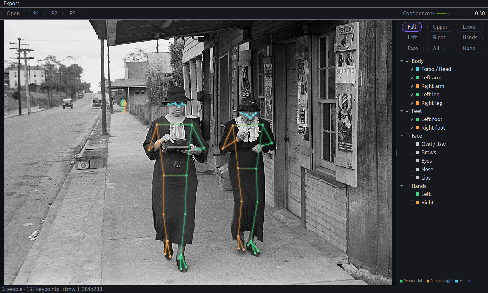
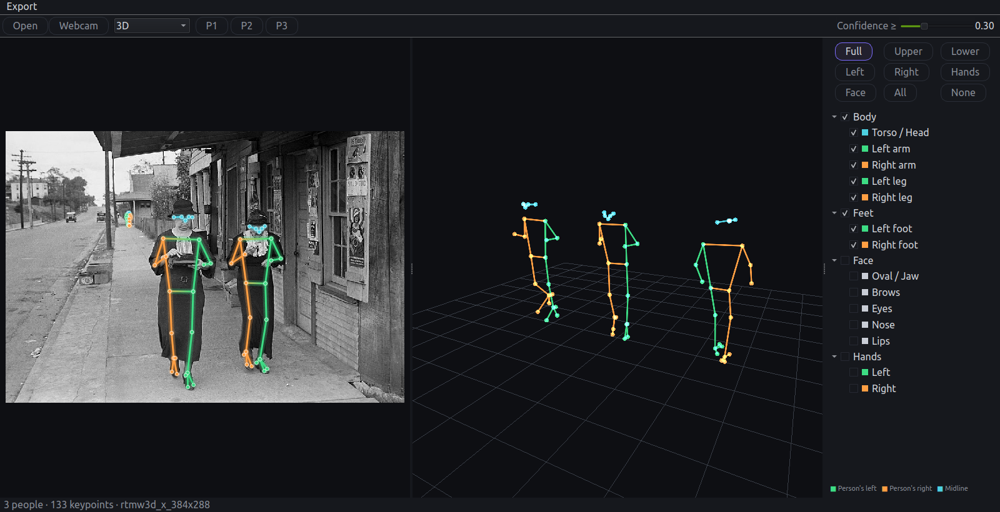
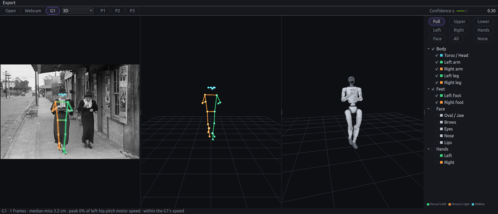

# AlchemyPose

[](https://pypi.org/project/alchemypose/)
[](https://www.python.org/)
[](https://github.com/astral-sh/ruff)
[](https://opensource.org/licenses/MIT)

Whole-body human pose over an image — **a typed Python library and a PySide6 desktop
application**, built on [RTMW](https://github.com/open-mmlab/mmpose/tree/main/projects/rtmpose)
and [YOLOX](https://github.com/open-mmlab/mmpose/tree/main/projects/rtmpose) through
ONNX Runtime.

Drop in a photograph. Every person in it gets 133 keypoints — body, feet, face and
both hands — and you choose what to look at: the whole skeleton, one hand, the left
leg, the face on its own.



> **4.1.0 — photographs, video, webcam, 3D and the Unitree G1.** `pip install alchemypose`, type
> `alchemypose`, and the window opens. Every person in the photograph you drop in
> comes back with 133 keypoints on a zoomable canvas, driven by a layer tree, preset
> chips and a confidence slider. The face resolves from contours to individual points
> as it grows on screen, and the Export menu writes the keypoints as JSON or CSV and
> the overlay as a PNG. Open a clip instead and every frame is analysed once in the
> background, each person tracked through it, while it already plays and scrubs; or
> switch on the webcam for live pose — see [Video and webcam](#video-and-webcam). The
> CLI produces the same results with no window at all. Pick the **3D** preset and
> every keypoint gains a depth, shown as an orbitable skeleton beside the picture and
> exportable as animated glTF — see [In 3D](#in-3d). Switch on **G1** and Unitree's
> 29-joint humanoid performs the same motion beside it — see
> [On a Unitree G1](#on-a-unitree-g1) — and `alchemypose retarget` writes that motion
> as reference data to train a G1 policy from — see
> [Training a G1 policy from a video](#training-a-g1-policy-from-a-video).

---

## Why

Most pose demos give you 17 body keypoints and a stick figure. AlchemyPose is built
around the thing that is actually hard once you have 133 of them: **deciding what to
show.** Face landmarks alone outnumber every other part combined, so the interface
is as much of the problem as the model.

It also stays light. No PyTorch, no MediaPipe, no `ultralytics` — the whole inference
path is ONNX Runtime, OpenCV and numpy, and the model files are fetched once at
runtime rather than shipped in the wheel.

---

## Install

```bash
pip install alchemypose
alchemypose
```

The second line opens the window: `alchemypose` on its own is the application.
`alchemypose --version` prints `4.1.0`, and the subcommands further down do the same
work with no window at all.

From source instead, if you have access to the repository:

```bash
git clone https://github.com/kouya-marino/AlchemyPose.git
cd AlchemyPose
python3 -m venv .venv && source .venv/bin/activate   # 3.12, 3.13 or 3.14
pip install -e ".[dev]"
```

**Python 3.12 or newer.** `requires-python` is `>=3.12` — a floor with no ceiling.
The floor is there because the *development* toolchain needs it: numpy ships type
stubs written in 3.12 syntax, which mypy cannot parse under 3.11. That is a reason
for a floor and not for a ceiling, so there is no upper bound; every dependency here
already supports 3.13 and 3.14. The suite has been run in full on 3.12 and on 3.14,
and CI runs it on 3.12, 3.13 and 3.14 on every push.

**Install weight, stated honestly.** The package itself is tiny — a 79 KB wheel of
pure Python — but two things behind it are not. `PySide6_Essentials` is a 106 MB
download on macOS, whose wheel is a universal binary, and 55 to 76 MB on Linux and
Windows; installed, it takes 328 MB on disk here. And the default model preset
fetches 253 MB of ONNX weights the first time you run inference — 235 MB over the
wire, since upstream ships them zipped. Both are one-time. The `lite` preset is
63 MB if you would rather trade accuracy for footprint.

On a bare Linux box the PySide6 wheel also needs a handful of system libraries it
links against but does not carry: `libegl1`, `libgl1`, `libx11-6`, `libxkbcommon0`,
`libfontconfig1`, `libdbus-1-3` and glib. The CI workflow installs exactly that set
and nothing more, and a runner has since loaded Qt's offscreen plugin with it.

---

## The keypoint schema

COCO-WholeBody 133, in contiguous index ranges that map directly onto the interface:

| Part | Indices | Count |
|---|---|---|
| Body | 0–16 | 17 |
| Feet | 17–22 | 6 |
| Face | 23–90 | 68 (dlib-68 order) |
| Left hand | 91–111 | 21 |
| Right hand | 112–132 | 21 |

Those ranges are grouped again into the 14 parts the UI exposes — `torso_head`,
`left_arm`, `right_leg`, `face_eyes`, `left_hand` and so on — joined by 127 edges.

The groups deliberately **overlap on anchor joints**: `left_arm` owns the shoulder
even though `torso_head` does too. Without that, asking for "just the left leg" draws
a shin — the thigh needs the hip, and a bone is only drawn when both of its endpoints
are visible.

```python
from alchemypose.core.presets import selection_for
from alchemypose.core.topology import COCO_WHOLEBODY_133 as topology

selection = selection_for("hands")          # or full_body, upper, lower, left_side, face …
bones = [e for e in topology.edges if selection.is_edge_visible(e)]
```

---

## Using it

### The window

```bash
alchemypose
```

That is the whole of it: no subcommand, no arguments. (`alchemypose gui` does the
same thing explicitly, and `python -m alchemypose gui` works too.)

`Cmd+O` opens an image — `Ctrl+O` on Windows and Linux, since the action takes Qt's
standard Open sequence. The photograph appears immediately and inference runs on a
worker thread, so the window never freezes; the skeleton lands when the model is done.
`Ctrl`+wheel zooms under the cursor (a bare wheel scrolls the view), and the middle
button drags to pan.

Everything on the right decides what is drawn. The layer tree is the single source
of truth — a two-level, tri-state list of render groups — and the preset chips above
it (Full, Upper, Lower, Left, Right, Hands, Face, All, None) simply set its check
states, so a chip lights up whenever the tree happens to equal it, including when you
got there by hand. With more than one person, the numbered chips in the toolbar
narrow everything to one subject.

On the canvas, clicking a joint emphasises its group and fades the rest; double-click
(or `Shift+H`) solos it and hides everything else; `Esc` or `Alt+H` puts it back.
Hovering reads the keypoint's name, confidence and group into the inspector.

Zooming into a face changes what is drawn on it and not merely how large it is.
Below about 80 pixels of face on screen it is drawn as contours in a single grey;
above that the brows, eyes, nose and lips take their own colours; and only above
about 200 pixels — where adjacent points are finally far enough apart to aim at —
are the 68 individual keypoints drawn at all. Sixty-eight dots on a thumbnail are a
smudge, whereas the contours through them read as a face at any size. The **Face**
chip zooms to the face as well as selecting it, which is what spares the window a
separate face mode.

### Getting it back out

The **Export** menu writes the keypoints as JSON or CSV, and the overlay as a PNG.
The PNG renders the scene rather than the widget, so it arrives at the photograph's
own resolution and is the same file whatever the zoom, the scroll position or the
shape of the window. A PNG needs only an open photograph; the two data formats need
a result. When there is nothing to write yet it says so in the status bar rather
than opening a dialog on an empty canvas.

### Video and webcam

**Open** takes a video as readily as a photograph — MP4, MOV, MKV, WebM, anything
FFmpeg reads. Frame 0 appears at once, a transport strip appears under the canvas,
and every frame is analysed in the background while the clip already plays: frames
that are done draw their skeleton, frames that are not draw the picture alone. When
it finishes, each person has a `track_id`, numbered by how much of the clip they are
in, so **P1** is whoever is on screen longest and the person chips mean the same
person on every frame. Passers-by seen for a handful of frames keep their tracks in
the data but do not get a chip.

`Space` plays and pauses, `←` / `→` step a frame, and the slider *is* the frame
index. Playback follows the wall clock rather than counting ticks, so a clip plays
in real time even when a 1080p frame takes longer than a frame's worth of time to
draw — it skips frames rather than slowing down.

**Smooth** steadies the skeleton between frames with a 1€ filter. It is applied when
drawing and nowhere else: the stored result, and therefore every JSON and CSV
export, is exactly what the model said frame by frame. Turning it off is free.

An analysis is cached on disk, keyed on the file's path, size and modification time
and on the preset, so reopening the same clip is a JSON read, not another pass
through the models. In video mode the Export menu writes the whole clip — every
frame, every person, raw — and the PNG is the frame on screen.

**Webcam** turns on live pose from the default camera. Each frame is drawn together
with its own pose — the frame is held until its result returns — so the skeleton
never trails the picture; when the model is slower than the camera, the display
runs at the model's rate instead.

Frame-accurate seeking uses PyAV, the `video` extra (`pip install
"alchemypose[video]"`). Without it, OpenCV — already a dependency — reads the same
files and seeks as accurately as the container's index allows, which is exact for
playing through and approximate for jumping around.

### In 3D

Pick **3D** in the toolbar's preset box and every person also gets a depth for each
of the 133 keypoints, from RTMW3D — the same keypoints in the same order, plus z. A
3D panel opens between the picture and the controls: an orbitable skeleton (drag to
orbit, middle-drag to pan, wheel to zoom) standing on a floor grid, drawn under
exactly the canvas's rules, so the layer tree, the presets, the person chips and the
confidence slider decide what appears in both, and the person's left is the same
green. In a video it plays in step with the clip, smoothed like the 2D overlay.



What the 3D is, precisely: metres, relative to the midpoint of the hips, in the
camera's axes (x right, y down, z away from the lens). RTMW3D gives the depth in
metres directly; the pixel offsets become metres by assuming a 0.5 m shoulder-to-hip
length and solving for the scale with the torso's own depth extent, so a body leaning
at the camera is not mistaken for a distant one. That makes every person adult-sized —
the far pedestrian above is as tall as the two women — and it makes the *directions*
of the bones trustworthy, which is what anything downstream needs. Where a person
stands in the world, and how far they travel, a single camera does not say, and this
does not guess.

On the reference dance clip the lifted skeleton holds up: left and right limbs agree
to a millimetre on median (upper arms 0.284 m and 0.283 m, thighs 0.416 m each),
forearm 0.25 m, shin 0.41 m, nose to ankle 1.51 m, and a bone's length varies 5–23%
from frame to frame.

**Export → 3D motion as glTF** writes the chosen person (or person 1) as an animated
`.glb`: a node per keypoint, named, with its motion sampled at the clip's timestamps,
and the bones as a line mesh skinned to those nodes, so it plays back as a skeleton in
Blender or any glTF viewer. glTF is y-up, so the axes are converted at that boundary
and nowhere else. The reference clip's file passes the Khronos glTF validator with no
errors and no warnings. From the shell: `alchemypose video clip.mp4 --preset 3d --gltf
clip.glb`.

The 3D view uses pyqtgraph over PyOpenGL — the `threed` extra, `pip install
"alchemypose[threed]"`. Without it, or on a machine with no display, the panel says so
instead of drawing.

### On a Unitree G1

Switch on **G1** in the toolbar and a third panel shows Unitree's 29-joint G1
humanoid performing the same motion — beside the clip and its 3D skeleton, in step
with every frame, from Unitree's own model and meshes. It needs depth, so it turns the
3D preset on if it is off.



**What it does.** Each frame's 3D skeleton becomes the G1's 29 joint angles. Not by
copying positions — a dancer and a 1.3 m robot have different limbs — but by
directions: every human limb is rebuilt on the robot's own link lengths, from its own
hips and shoulders, and the robot's knees, ankles, feet, shoulders, elbows, wrists and
hands are solved onto those targets inside its joint limits. Rigid end segments are
matched as frames — the torso by its up and across axes, each foot by its heel-to-toe
line — so the robot is never asked for two foot points its rigid foot cannot reach at
once. The torso's facing goes into the pelvis; the joint angles are relative to it.

**How well, on the reference dance clip** (300 frames, Linux): the robot's points land
a median 3.6 cm from their targets (8.7 cm at the 95th percentile, which is where the
tracked right arm glitches), in about 30 s for the clip. A perfectly neutral human —
arms and legs hanging straight — comes out as the robot's own neutral pose, within
3 mm. The fastest joint peaks at 45% of its motor's rated speed, so the dance fits the
robot as recorded. The G1's ankle roll travels only ±15°, and reaches that limit in
about a fifth to a third of the clip's frames.

*Corrected in 4.1.0:* 4.0.0 said here that the ankle roll sat at its limit "for most of
the clip" because of the dancer's wide stance. The stance was not the cause. The
retarget started each leg and arm at the hip and shoulder joints, but the G1's rest
thighs and upper arms slant outwards, so a human limb hanging straight down pulled the
robot's inwards — a neutral human came out knock-kneed, ankles 0.11 m apart against
0.24 m at rest. 4.1.0 starts each limb from a point above the robot's rest knee or
elbow, and the pinning fell from 85% of frames to the figure above.

**Too fast for the robot?** Every retarget is checked against the URDF's velocity
limits, and the status bar says if a motion needs more than half of any motor's rated
speed and how much slower it must play to stay inside that — and the transport's speed
box drops to the nearest rate that fits. The check measures exactly the trajectory
that is played, after its light zero-phase smoothing, so a fast moment is never
averaged away.

**What it is not.** This is kinematics: joint angles, not torques; nothing here knows
the robot's mass, balance or contact forces, and nothing connects to a robot. A pose
the G1 can be put in is not always one it can hold — training a policy in simulation is
what makes a motion balanceable. The next section writes the file for that.

### Training a G1 policy from a video

`alchemypose retarget` turns a clip into *reference motion*: the per-frame target a
motion-tracking policy is trained to follow in simulation (DeepMimic-style, as in
BeyondMimic, ASAP or Isaac Lab's tracking tasks).

```console
$ alchemypose retarget dance.mp4 --npz dance_g1.npz --csv dance_g1.csv --check
300 frames at 30 fps · median miss 3.6 cm · peak 45% of right_shoulder_yaw_joint speed · slowed 1.00x · root fixed
Wrote dance_g1.npz
Wrote dance_g1.csv
BeyondMimic: python scripts/csv_to_npz.py --input_file dance_g1.csv --input_fps 30 --output_name dance_g1 --headless
300 frames played through MuJoCo (kinematics only)
  link positions vs this package's FK: worst 0.001 mm
  lowest point: -0.2 cm; frames >1 cm under the floor: 0
  frames with self-contact: 74 (e.g. left_hip_roll_link / left_wrist_yaw_link)
  joint samples outside the MJCF's ranges: 0
```

It runs the `3d` analysis (cached), the same smoothing and retarget as the window, and
then builds the reference. The Export menu writes the same two files from the G1 on
screen.

**The two files.** The `.npz` is the native one, every array named — `joint_names`
beside `joint_pos`, `quat_order` (`"wxyz"`) beside `root_quat` — with `fps`, `times`,
`root_pos`, `joint_vel`, `root_lin_vel`, `root_ang_vel`, left/right foot `contacts`, an
`interpolated` mask, the per-frame retarget miss, and a JSON `metadata` record of
everything that made it (the pinned URDF and its SHA-256, the root mode, the
slow-down, the speed budget, units, and which parts are estimates). The `.csv` is
Unitree's own layout for retargeted G1 motion, which BeyondMimic converts directly: no
header, 36 columns — root position, root quaternion **x y z w**, then the 29 joints in
the URDF's order. MuJoCo wants the same 36 numbers with the quaternion **w x y z**;
both orders were checked rather than assumed — Unitree's published dance data, read in
this layout and played through their MJCF, stands on the floor (ankles at 5 cm), and
read in the other order hangs upside down (ankles at 1.5 m).

**Slower, to fit the motors.** `--slow auto` (the default) plays the motion as slowly
as it takes to keep every joint within `--budget` (default 0.5) of its rated speed,
and `--slow 1.5` slows it by a set factor. Velocities are differences of the final,
slowed trajectory, and the reported peak is measured on exactly that.

**The root is the estimate.** One camera gives joint angles well and the body's place
in the world badly. The pelvis height puts the lowest sole corner on the floor; its
orientation is its heading only (a monocular pelvis has no trustworthy pitch or roll).
Travel is `--root fixed` (the default: none — right for dancing on the spot) or
`--root planted`, which holds the stance foot still and moves the body accordingly, so
steps carry it across the floor; that cannot represent a jump, and the file says
"estimated" next to it.

**`--check`** plays the file through Unitree's own MuJoCo model (the `sim` extra,
`pip install "alchemypose[sim]"`): MuJoCo's link positions against this package's
forward kinematics (the proof the conventions are right), the lowest point, frames
with the robot's own parts touching, and joints outside their ranges. Self-contacts are
expected at roughly this rate — Unitree's own published dance shows 75 in 600 frames
with the same model — and are the trainer's to resolve.

This is a kinematic reference for training and simulation. It is never to be streamed
to a robot's motors: it knows nothing of balance, and a real G1 would fall.

**The model.** `g1_29dof_rev_1_0` from [unitree_ros](https://github.com/unitreerobotics/unitree_ros)
(BSD-3-Clause, © Unitree Robotics), pinned to one commit, fetched once at runtime — the
URDF, its MuJoCo twin and the 35 meshes it draws, 19 MB — and verified file by file,
like the pose models. Nothing of it is in the wheel. The forward kinematics agree with
MuJoCo's to 10⁻¹⁵ m on that URDF, and to half a micrometre on Unitree's own MJCF. If
your G1 reports a newer `mode_machine` (the `mode_11`–`mode_16` models), joint names,
order and limits are the same; only the wrist geometry differs.

### On an NVIDIA GPU

Video is where speed matters: the analysis runs the models once per frame. ONNX
Runtime's CUDA build is used automatically when it is installed in place of the
default one:

```bash
pip uninstall -y onnxruntime onnxruntime-gpu
pip install "onnxruntime-gpu[cuda,cudnn]"
```

Run both lines again after any `pip install -U alchemypose`. The two builds install
the same `onnxruntime` package, and upgrading AlchemyPose reinstalls the CPU one,
which then shadows the GPU build: CUDA disappears and everything quietly runs on the
CPU. AlchemyPose logs a warning naming this fix when it sees both installed and no
CUDA.

Both the detector and the pose model then run on the GPU, each proved by one
throwaway inference first and demoted to the CPU if that fails. Measured on an RTX
4070 laptop GPU, Linux: YOLOX-s 12 ms and RTMW-l 14 ms per run, against roughly
850 ms per frame for the pair on that machine's CPU — a ten-second 1080p dance clip
(300 frames) analysed on `performance` in 22 s rather than four minutes.

### One image, from the shell

```console
$ alchemypose image tests/integration/fixtures/two_people.jpg --preset lite --json /tmp/out.json
Wrote /tmp/out.json
```

That path is the test fixture in the source tree — a public-domain 1935 photograph of
two people — so substitute any photograph of your own and the numbers below become
yours. ONNX Runtime also writes a few `[W:onnxruntime:…]` lines to stderr while it
builds a session, about unused initializers and how much of the graph CoreML took;
they are notices, not errors, and stdout carries only the line above.

Without `--json` the result goes to stdout; `--csv` also writes the flat
`frame,person,keypoint_index,keypoint_name,x,y,score,track` form (`track` is empty for a still). The JSON carries the
topology inline, so a result stays readable years later without this package:

```console
$ python - <<'PY'
import json
import numpy as np
r = json.load(open("/tmp/out.json"))
frame = r["frames"][0]
print(r["model"], frame["image_size"], len(frame["people"]), "people")
for i, p in enumerate(frame["people"]):
    s = np.array(p["scores"])
    print(f"person {i}: {len(p['keypoints'])} keypoints, confidence {s.min():.2f}-{s.max():.2f} (median {np.median(s):.2f})")
PY
rtmw_m_256x192 [982, 670] 2 people
person 0: 133 keypoints, confidence 0.56-1.00 (median 0.94)
person 1: 133 keypoints, confidence 0.61-1.00 (median 0.90)
```

Weights are fetched on first use. To pay for that up front:

```console
$ alchemypose models fetch --preset lite
Fetching yolox_nano ...
Fetching rtmw_m_256x192 ...
Done.

$ alchemypose models list
Cache: /Users/you/Library/Caches/alchemypose

lite:
  yolox_nano             cached
  rtmw_m_256x192         cached

balanced:
  yolox_tiny             cached
  dwpose_l_384x288       cached

performance:
  yolox_s                cached
  rtmw_l_384x288         cached
```

### A video, from the shell

```console
$ alchemypose video dance.mp4 --preset performance --json dance.json --csv dance.csv
Analysing 300/300 frames (14.8 fps)
300 frames, 7 tracked people, in 21.8 s
Wrote dance.json
Wrote dance.csv
```

The JSON is the same document as for a photograph with more than one frame in it,
each frame carrying its `frame_index` and `timestamp_s` and each person its
`track_id`; the CSV's last column is the track. Seven tracks there is one dancer,
present in all 300 frames as track 0, and six one-to-three-frame detections of people
in the far background. `--det-interval N` runs the detector every N frames and crops
the frames between from the previous pose, which is cheaper and fine for a clip with
one person in it; `--no-cache` forces a fresh analysis.

### What a score means

Every keypoint carries a confidence in `[0, 1]`, and it means the same thing whichever
preset produced it. That took work: the RTMPose-family graphs end in a bare `MatMul`
— no softmax, no sigmoid — so the raw SimCC peak is a logit whose height depends on
the model's training temperature. Measured on real output, a confident peak reaches
about 1.0 on RTMW-m and DWPose-l but an order of magnitude more on RTMW-l — 8.576 was
the highest of the fixture's 399 — which made a fixed 0..1 threshold meaningless
across presets and inert on the default one. Each pose model's `ModelSpec.peak_scale`
records the divisor, 1.0 for the first two and 10.0 for RTMW-l, and decoding divides it out and
clips to [0, 1]. It is a monotone confidence, not a calibrated probability — nothing
in the training objective makes it one.

The window's slider filters on exactly that number and starts at **0.30**. Below it a
keypoint is not drawn at all; from there the drawing fades in, reaching full opacity
at 0.55, and a bone whose weaker end is under 0.25 is drawn dashed. Those three
numbers were calibrated against measured score distributions, not chosen by eye.

---

## Models

Weights are downloaded on first use into the platform cache directory
(`~/Library/Caches/alchemypose` on macOS, `~/.cache/alchemypose` on Linux; override
with `ALCHEMYPOSE_MODEL_DIR`) and verified against a recorded SHA-256. Nothing is
vendored in the repository or the wheel.

| Preset | Detector + pose model | On disk | Detection | Pose model, per person |
|---|---|---|---|---|
| `lite` | YOLOX-nano + RTMW-m 256×192 | 63 MB | 8 ms | 4 ms |
| `balanced` | YOLOX-tiny + DWPose-l 384×288 | 148 MB | 15 ms | 14 ms |
| `performance` *(default)* | YOLOX-s + RTMW-l 384×288 | 253 MB | 42 ms | 25 ms |
| `3d` | YOLOX-s + RTMW3D-x 384×288 | 387 MB | 12 ms¹ | 16 ms¹ |

¹ The `3d` row was measured on Linux with an RTX 4070 laptop GPU (CUDA), not on the
M5 like the rows above, so its timings are not comparable with theirs. On that
machine's CPU provider the same two models take 400 ms (YOLOX-s, per frame) and
610 ms (RTMW3D-x, per person) — about five minutes for a ten-second, one-person clip.

Sizes are the extracted `.onnx` files as they sit in the cache, in binary megabytes —
the figures `ls -lh` and `du -h` print — so the three rows add up to the 464 MB all six
files occupy together. Upstream ships them inside zips, so the transfer itself is
slightly smaller (59 / 138 / 235 MB).

The timings are medians of fifteen warm runs on one 982×670 photograph on an M5, with
the split described below — the detector on the CPU provider, the pose model on
CoreML. Detection is per frame whatever the head count; the pose column is per
detected person. End to end that photograph takes 17 ms on `lite` (2 people found),
58 ms on `balanced` and 114 ms on `performance` (3 people found). Opening the models
costs another 1–3 seconds once per process, before the first inference.

The person detector runs on the CPU execution provider and the pose model on CoreML.
That split is not a tuning choice, though the reason is narrower than "CoreML cannot
load that graph". It loads it — the session is created and reports both providers —
and then raises a rank mismatch on the first `run()`, inside the partition holding
YOLOX's baked-in NMS. Sessions are therefore proved with one throwaway inference on
zeros and demoted to CPU if it fails.

All model weights are Apache-2.0, from the MMPose project.

---

## Architecture

Layers, with the Qt boundary enforced by a test:

```
core/        topology · schema · presets · serialization · H36M mapping ·
             tracking · smoothing · metric 3D lifting · glTF
             no Qt, no onnxruntime — pure data, testable anywhere

media/       reading an image as upright BGR, EXIF applied · reading a video
             by frame index (PyAV, or OpenCV), rotation applied

inference/   ONNX sessions · YOLOX detection · SimCC decoding · weight cache ·
             the worker thread · the offline video pass and its cache —
             no Qt, so it is testable headless

robot/       the Unitree G1: pinned, verified assets · URDF and forward
             kinematics · binary STL · retargeting and the speed check ·
             reference-motion export · the MuJoCo check — no Qt, no OpenGL

gui/         PySide6: canvas · layer tree · preset and person chips ·
             confidence slider · inspector · transport · video and webcam modes ·
             the 3D panel and the G1 panel (pyqtgraph; their geometry is
             built without OpenGL)
```

`import alchemypose` pulls in no Qt at all — the application class resolves lazily —
so the library half runs headless, in CI, and on a machine with no display. The
inference worker is plain `threading`; `gui/bridge.py` is the only place it meets Qt,
and it does so by emitting signals, so nothing on a worker thread ever touches a
widget.

One result structure serves every phase. `PersonPose` carried `track_id` and
`keypoints_3d` fields from the first commit; video filled `track_id` without a schema
change, and 3D will fill the other the same way.

Two policies, on purpose. The worker is latest-request-wins: right for a still and
for the webcam, where a frame nobody is looking at any more is worth dropping. A clip
is the opposite — playback beside a 3D skeleton needs every frame — so video has its
own offline pass that analyses each frame once, in order, and playback then reads the
result by `frame_index` and never waits on a model.

---

## Roadmap

**v1 — single image.** Shipped in 1.0.0; its leftovers closed in 1.1.0.

- [x] COCO-WholeBody 133 topology, render groups, presets
- [x] Result schema with reserved video/3D slots
- [x] JSON and CSV serialization
- [x] COCO → H36M-17 mapping (the seam 3D lifting plugs into)
- [x] Model registry with cached, checksum-verified downloads
- [x] ONNX sessions with the CPU/CoreML provider split
- [x] SimCC decoding and top-down affine cropping
- [x] YOLOX detector and the assembled pose engine
- [x] Inference worker and CLI
- [x] Canvas, layer tree, preset chips, selection
- [x] Confidence: honest 0..1 scores, threshold slider, fade and dashed bones
- [x] Face level of detail
- [x] Export from the window

**v2 — video.** Shipped in 2.0.0.

- [x] Video reading by frame index — PyAV (frame-accurate) or OpenCV — rotation applied
- [x] Offline pass over every frame, cached on disk; play and scrub while it runs
- [x] `track_id` populated: IoU tracking, renumbered by presence
- [x] 1€ smoothing at draw time; stored coordinates stay raw
- [x] Webcam, through the latest-request-wins worker
- [x] `alchemypose video` on the command line
- [x] CUDA, when `onnxruntime-gpu` is installed

**v3 — 3D.** Shipped in 3.0.0.

- [x] RTMW3D as the `3d` preset: the same 133 keypoints plus a depth head
- [x] `keypoints_3d` populated: metric, root-relative, OpenCV axes
- [x] The orbitable 3D panel, on the `threed` extra (never QtQuick3D or QtGraphs)
- [x] Animated, skinned glTF export, y-up at the boundary only

**v4 — the Unitree G1.** Shipped in 4.0.0.

- [x] Unitree's G1 model, pinned and verified, with forward kinematics checked against MuJoCo
- [x] Retargeting onto its 29 joints, inside its limits, with the speed check
- [x] The robot beside the clip and its 3D skeleton, in step, with playback speed

**v4.1 — a robot-motion export to train from.** Shipped in 4.1.0.

- [x] `alchemypose retarget`: `.npz` (named arrays) and Unitree's CSV, from a video
- [x] Root height, heading and optional planted travel, each labelled as an estimate
- [x] Slow-down to fit the motors, with velocities from the final trajectory
- [x] A MuJoCo kinematic check against Unitree's own model (the `sim` extra)

---

## Development

```bash
pytest                        # the whole suite; the GUI half runs headless by itself
pytest tests/unit -q          # core and inference; no display needed
ruff check src tests main.py
mypy
mypy main.py
QT_QPA_PLATFORM=offscreen pytest tests/gui -m gui
pytest tests/integration -m models    # skipped unless weights are cached
```

At the time of writing that is 705 tests. On a machine with the weights cached they
all pass, bar the two that need CoreML and skip anywhere else — measured on Linux,
703 passed and 2 skipped. Twelve are marked `models` — two in `tests/unit`, ten in
`tests/integration` — and check the cache rather than downloading anything, and one
README test compares the stated download size against the cached files, so without
weights the same Linux run reports 690 passed and 15 skipped (the extra two parse the
cached G1 meshes and play a motion through MuJoCo, which needs them). The robot tests need no network: the G1's URDF is a test fixture,
with Unitree's licence beside it, and MuJoCo's link poses for it are recorded there. The video tests encode
their own clips with PyAV (a `dev` dependency) and never touch a file on disk beyond
`tmp_path`. `main.py` sits outside `src/`, so neither
`ruff check src tests` nor a bare `mypy` reaches it; it needs naming, which is why it
appears twice above.

**`ruff format` is deliberately not used.** The project gates on `ruff check`, and the
formatter would collapse the column-aligned trailing comments the code relies on to
read as tables — the `Space` members, the `PersonPose` fields, the detector's test
rows — into single-space comments. That alignment is doing work, so the formatter is
not, and CI does not run it.

The GUI tests need a Qt platform plugin, not a display: `offscreen` renders into a
buffer, so there is no xvfb anywhere in this project. They do not need that variable
on the command line, though — `tests/gui/conftest.py` sets it itself, at import,
before any widget can be constructed, so a bare `pytest` runs them headless too.
Setting it explicitly is belt and braces, and it is what the CI step does.

CI (`.github/workflows/ci.yml`) runs the test suite on **Python 3.12, 3.13 and 3.14**
— the whole of what `requires-python = ">=3.12"` now claims — and runs `ruff` and
`mypy` exactly once, in a job of their own. Both are static analysers configured
against fixed targets (`target-version = "py312"`, `python_version = "3.12"`), so
they return the same answer whichever interpreter invokes them; three copies of one
answer is not a broader gate, only a longer log. The tests are the part that actually
varies by interpreter, so the tests are the part that gets the matrix.

Nothing on a runner ever downloads weights, so the `models`-marked tests never
actually execute there. They skip, which is a green tick meaning *not exercised*
rather than *passed*.

**It has run, and it passed** — though on the single-interpreter shape this workflow
had until 1.0.0, so read the numbers below as 3.12's. Six runs so far, every one a
push to `main` and every one successful, each finishing in about a minute on
`ubuntu-latest`. The most recent reported `ruff` clean, `mypy` with no issues across
38 source files and then across `main.py`, 289 passed and 2 skipped in `tests/unit`,
179 passed in `tests/gui`, and 10 skipped in the weights-only step. It also printed
`Qt 6.11.2 on platform offscreen`, which is the line worth having: the list of Linux
system libraries further up was derived by reading the PySide6 wheel's ELF headers
rather than by watching a runner install them, and a runner has now loaded the
offscreen plugin with exactly that list present and nothing more.

**The 3.13 and 3.14 legs are new, and have not had a push to run on yet.** What has
been measured for the widened range is local: the full suite under Python 3.14.7, in
a clean virtualenv built from the released dependency set, with the package installed
from a source tree of its own so that nothing resolved back to the development
checkout — 511 passed, 0 skipped, `pytest` exit status 0. Weights were present, so
the twelve `models` tests ran against the real ONNX graphs rather than skipping.
`ruff` and `mypy` were run under 3.14 as well and returned exactly what they return
under 3.12, which is the measurement behind giving them one job instead of three. The
same tree's 1.0.0 wheel installs and runs on 3.14; built with the old `<3.13` ceiling
it does not, and pip says so — `requires a different Python: 3.14.7 not in
'<3.13,>=3.12'` — which is what the ceiling was doing to everyone on a current
interpreter. 3.13 is the gap: no 3.13 interpreter exists on the machine these numbers
were taken on, so that leg is claimed by the matrix and not yet by a run.

What that tick does not cover is the half of the project that needs weights. CoreML,
the timings and the score distributions on this page have only ever been measured on
one Apple-silicon machine.

**The suite used to pass and then abort. It no longer does.** It would die during
interpreter shutdown — `libc++abi: terminating due to uncaught exception of type
std::__1::system_error: recursive_mutex lock failed: Invalid argument`, exit status
134, printed *after* the summary line had gone by. The cause was onnxruntime's
telemetry client, which uploads on a thread of its own; at exit the teardown of its
log manager frees a mutex an in-flight upload then tries to lock. `tests/conftest.py`
now sets `ORT_DISABLE_TELEMETRY=1` before anything imports onnxruntime, which is the
only moment the setting is read. Measured here over 40 runs per arm, interleaved:
0 aborts with it, 4 without.

Run the suite as `pytest -q > out 2>&1; rc=$?` and read `rc` anyway. A pipeline such
as `pytest -q | tail -1` reports the exit status of `tail`, so it would have hidden
that abort entirely for as long as it lasted, and it will hide the next one.

### Releasing

A release is a tag. Pushing `v1.0.0` runs `.github/workflows/publish.yml`, which
re-runs every gate above on the tagged commit and then uploads to PyPI through
trusted publishing, so no API token exists anywhere in this repository. It is the one
irreversible thing here: PyPI never allows re-uploading a version, and yanking a
release does not give its number back. So the tag is spent only after the artefacts
themselves have been read — the tag is matched against the version in
`src/alchemypose/__init__.py`, then against the metadata inside the built wheel and
sdist; the wheel's `Requires-Python` is compared against the one in `pyproject.toml`,
because the string pip enforces is the one baked into the artefact and a wrong range
published there cannot be edited afterwards, only yanked; both archives are searched
for weights, `test-data/`, `docs/` and the test suite; the wheel is checked for a
top-level `main`, because `main.py` is a checkout convenience and not ours to install
into anyone's `site-packages`; and the wheel is installed into a throwaway virtualenv
where each entry point is run and asked its version. That first check reads the attribute with `ast`, the way setuptools'
`attr:` does, rather than reading `project.version` — with the version declared once
and exposed through `dynamic = ["version"]`, that key does not exist here.

The PyPI and Python badges at the top of this file are **static and version-pinned**,
not the dynamic `shields.io/pypi/…` kind. Those proved unreliable: PyPI's JSON API
serves a stale `info.version` for some time after an upload, shields.io caches
whatever it read for three hours, and GitHub's image proxy then caches shields. The
three compound, and the badge showed a version four releases behind. A pinned badge
cannot be stale — and the release fails if either badge stops agreeing with what the
package declares, so it cannot be forgotten either. The Python badge is held to the
whole `Programming Language :: Python ::` classifier list rather than just to the
`requires-python` floor: now that it names a range, checking only its first number
would wave the rest of it through.

---

## Licence

MIT — see the `LICENSE` file in the source distribution.

Model weights are Apache-2.0 from [MMPose](https://github.com/open-mmlab/mmpose)
and are downloaded at runtime, not redistributed here. The Unitree G1 model is
BSD-3-Clause, © Unitree Robotics, from
[unitree_ros](https://github.com/unitreerobotics/unitree_ros); it is downloaded at
runtime, and its URDF alone is copied into `tests/fixtures/unitree_g1/` with that
licence beside it.
